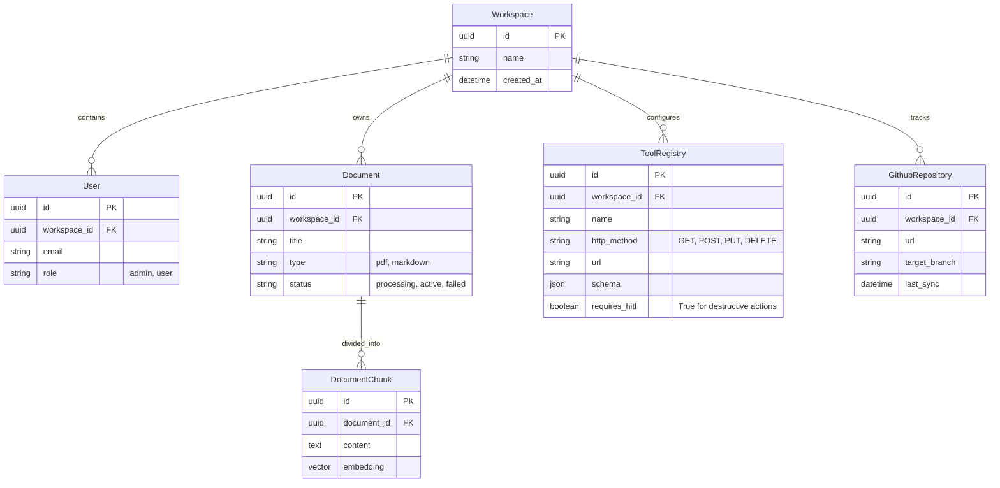

# 02 Database Schema

## Document Metadata
- **Status:** Approved
- **Scope:** Forward-Looking (Supports MVP & V1)
- **ORM:** SQLModel (PostgreSQL)
- **Last Updated:** 2026-10-30

---

## 1. Schema Overview

This schema is designed to be multi-tenant (using `workspace_id` on all core tables) and forward-looking. `GithubRepository` exists as a table only. Sync stays out of the MVP.

## 2. Table Definitions (SQLModel Implementation Notes)

### 2.1. `Workspace`
The root tenant for a business utilizing the A²I platform.
- Every subsequent table (except users mapping to it) *must* contain a `workspace_id` to ensure strict tenant isolation during queries.

### 2.2. `Document` & `DocumentChunk` (MVP)
- **`Document`**: `workspace_id`, `title`, `type` (`pdf` / `markdown` / `text`), `status` (`processing` / `active` / `failed`), `original_filename`, `error_message`, `created_at`. Status drives the Processing and Active badges.
- **`DocumentChunk`**: `document_id`, `content`, `embedding vector(1536)`, `chunk_index` (unique per document), optional `metadata` JSONB.
- Embeddings are OpenAI `text-embedding-3-small` (1536). That size is fixed in `backend/app/core/embeddings.py`. Cosine HNSW index: `ix_document_chunk_embedding_hnsw`.

### 2.3. `ToolRegistry` (MVP)
- `workspace_id`, `name` (unique per workspace), `kind` (`http` / `js`), `http_method`, `url`, `schema` JSONB, `requires_hitl`, `description`, `is_active`.
- The `schema` column uses PostgreSQL `JSONB` for the tool parameters.
- `requires_hitl` is the hard-lock that stops a write until the user confirms it in the widget. The API will force it on for POST, PUT, and DELETE.

### 2.4. `GithubRepository` (V1 - table only)
- `workspace_id`, `url`, `target_branch`, `last_sync`.
- No OAuth, webhooks, or sync workers until V1.
